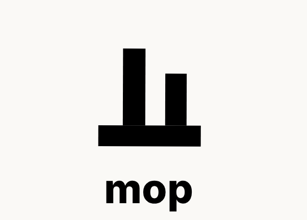

# mop

<div align="center">
  
</div>

A coding agent for **character cards**.

mop builds and revises JanitorAI-style character cards, their lorebooks, and the worldbuilding they rest on. It is a fork of [oh-my-pi](https://github.com/can1357/oh-my-pi) (MIT) with the agent surface replaced.

## Why it is built this way

Most agent frameworks put the whole domain in the system prompt. mop does not.

There are **two agents** — a main agent and a read-only one — and both are light skeletons. Everything else lives in **skills**: a short `SKILL.md` that says when it applies, what the workflow is, and which reference file to read at which step. The heavy material (the card schema, the macro rules, the anti-slop rubric, the reference lorebook, the voice-profile format) sits in reference files that the agent loads only when it reaches that step.

The result is a prompt that stays small and a domain you can extend without touching the runtime.

```
skills/
  card-anatomy/SKILL.md          router
    references/four-box-model.md  heavy material, loaded on demand
```

## The skill catalog

| Skill | What it covers |
|---|---|
| `card-anatomy` | The four platform boxes, what is permanent, the card file format |
| `card-authoring` | Writing a card from a concept; the opening message and its hook |
| `card-rewrite` | Deslop and tighten an existing card; the iteration loop |
| `anti-slop` | The quality bar: the anatomy of a bad card, the banned patterns |
| `macro-rules` | `{{user}}` / `{{char}}` semantics and the forms that break |
| `token-economics` | The budget bands and when to offload instead of cut |
| `lorebook` | World Info JSON: hub, entries, cascade, sizing |
| `lore-library` | The durable store: layout, search, the save protocol |
| `worldbuilding` | Authoring a world as a system |
| `voice-profile` | Building a reusable profile from sample cards |
| `review` | Deep review through prose, lore, macro, and structure lenses |
| `forensics` | Statistical analysis of generated prose |
| `section-drafts` | Several distinct takes on one section |

## Layout

```
mop/
├── packages/
│   ├── coding-agent/           the agent (primary package)
│   │   ├── skills/              the JanitorAI domain: routers + reference files
│   │   ├── src/skills/          bundled-skill provider and index codec
│   │   └── src/prompts/        agent and system-prompt markdown
│   ├── agent/  ai/  catalog/   runtime, providers, model catalog
│   ├── tui/  ui/  natives/     terminal UI, native perf addon
│   └── ...
├── crates/                     Rust native crates (pi-*): perf only
└── scripts/install.sh          installer
```

mop keeps omp's single-runtime shape: the Bun/TypeScript `coding-agent` package *is* the agent, and the Rust crates are a performance addon (in-process grep, glob, shell, AST) rather than a second implementation. jclaw carried two runtimes and a parallel 35k-LOC Rust agent that did nothing — that is the weight mop drops.

## Configuration

| Path | Contents |
|---|---|
| `~/.mop/agent/` | Settings, models, sessions, credentials, the lore library |
| `~/.mop/skills/` | The bundled skill corpus (materialized on first run) |
| `<project>/.mop/` | Per-project settings, skills, agents, commands |

To override a bundled skill, put your own copy in a `skills.customDirectories`
directory: a custom-directory skill outranks a provider skill, so yours takes
the canonical name and the bundled one steps aside under a namespaced alias.

## Development

```sh
bun install
bun run build:native          # Rust addon (host builds do not need bazel)
bun run dev                   # run from source
bun run check                 # lint + typecheck + Rust checks
```

Build a standalone binary:

```sh
bun --cwd=packages/coding-agent run build
```

## Status

Milestone 1 — the shape, end to end:

- [x] Fork of oh-my-pi, rebranded surface: binary `mop`, config `~/.mop`, internal URL scheme `mop://`
- [x] Main agent skeleton (`packages/coding-agent/src/prompts/system/mop-system-prompt.md`)
- [x] Read-only agent (`packages/coding-agent/src/prompts/agents/reader.md`)
- [x] 13 skill routers with reference files (`packages/coding-agent/skills/`)
- [x] Bundled-skill delivery for source checkouts, npm packages, and compiled binaries
- [x] Installers for GitHub releases (`scripts/install.sh`, `scripts/install.ps1`)

Still open:

- [ ] The analyzer tools (`card_budget`, `card_macro_check`, `tokenize`, `text_entropy`, `text_fingerprint`, `ghost_phrase_scan`, `library_search`)
- [ ] Full reference-file content port
- [ ] Trim the inherited agent roster to the two mop agents
- [ ] Rename the SDK packages (`omp-rpc` → `mop-rpc` in python, go, rust) so a published mop does not collide with upstream
- [ ] Release pipeline: GitHub release assets and the `mop update` backend

## License

MIT, inherited from oh-my-pi. See [LICENSE](LICENSE) for the full text and upstream attribution.

oh-my-pi is © Mario Zechner, Can Bölük, and Stencil Labs, Inc. mop is a fork of [can1357/oh-my-pi](https://github.com/can1357/oh-my-pi).
